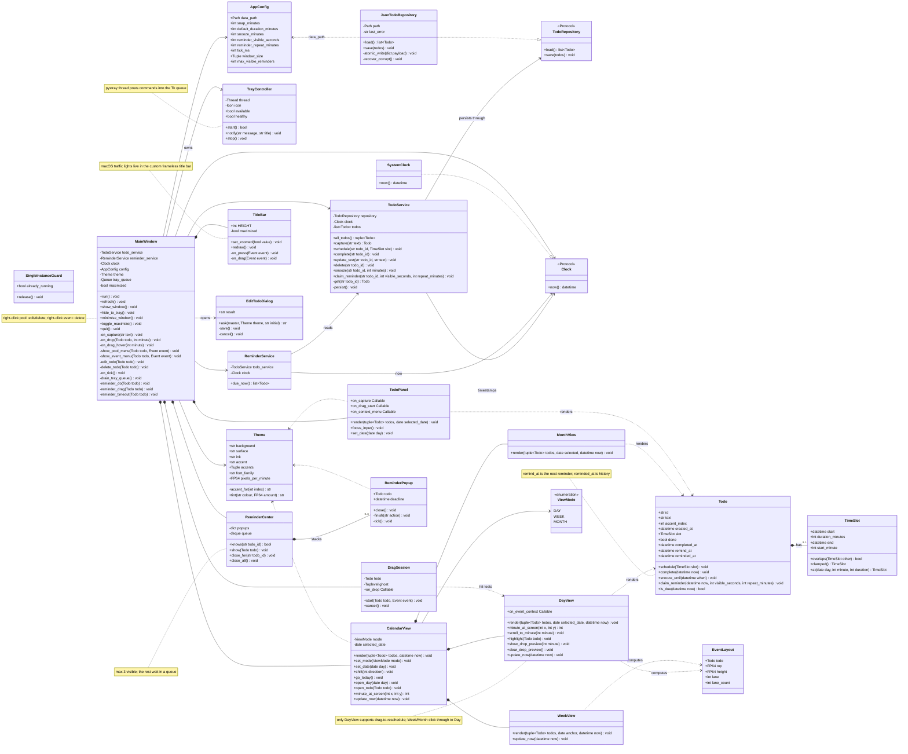
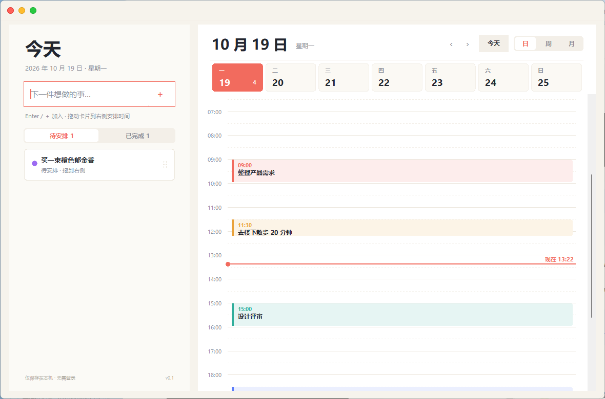
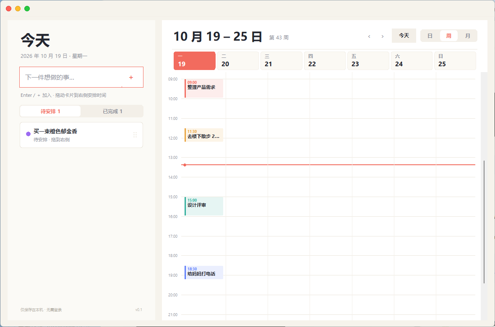
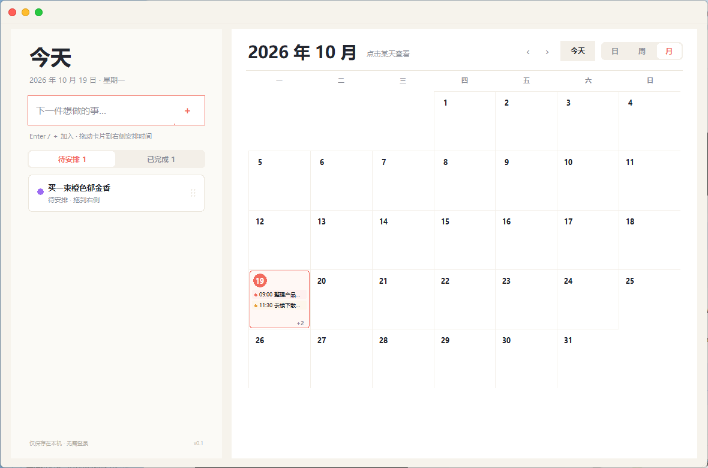
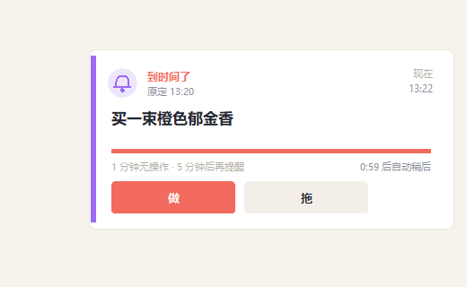
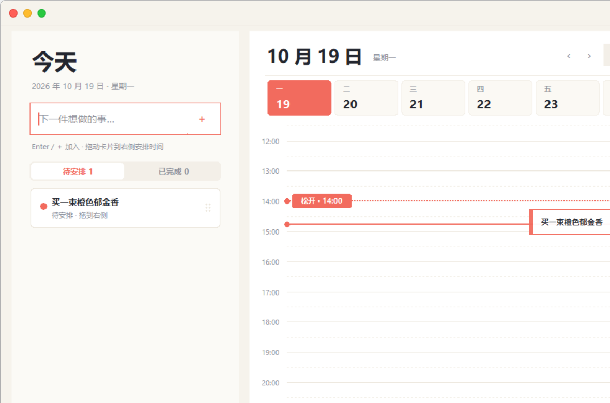

# 色彩待办 · 预架构 v3

> 状态：你的决策已落地到可运行版本；32 项测试通过；`dist\ColourTodo\ColourTodo.exe` + `dist\ColourTodo-win64.zip` 已构建。
> 日期：2026-10-19
> 设计图：[日视图](design/ui_main.png) · [周视图](design/ui_week.png) · [月视图](design/ui_month.png) · [提醒弹窗](design/ui_reminder.png) · [拖拽落点预览](design/ui_drag_preview.png)

---

## 0. 命名与视觉反馈

### 为什么叫 ColourTodo？

`ColourTodo` 是我起的**临时工作名**，就是 `Colour + Todo`，对应中文“色彩待办”，用来呼应“以色彩为主题”的外观；它不是缩写，也没有隐藏含义。你看到的 `colotodo` 是因为我用了英式拼写 `Colour`。

显示名可以随时改，代码里用 `colour_todo` 包名和 `ColourTodo` 数据目录只是为了稳定；如果改名，数据目录需要一次迁移。名字本身不影响架构。

### 窗口控制：macOS 红黄绿圆点

按你的要求，窗口控制改成 **macOS 风格的红黄绿三个圆点，放在左上角**：

- 红：关闭窗口（托盘可用时收起到通知区域；托盘不可用时直接退出）。
- 黄：最小化到任务栏。
- 绿：最大化 / 还原；双击标题栏也可切换。
- 拖动标题栏空白处移动窗口；右下角有缩放把手。
- 左侧“色彩待办”品牌文字和彩色细条已删除。
- 鼠标移到红黄绿上显示手型光标；标题栏空白处才是四向拖动光标。
- 三个圆点用 4× 超采样 + LANCZOS 生成图片，不再用 Tk 原生椭圆，边缘不再是锯齿。
- 之前选中日期右侧的三个圆点是事件数量点，也改成了数字角标，避免和窗口控制混淆。

---

## 1. 目标与边界

**产品目标**：本地、单用户的 Windows 待办 app。自由输入待办，按 Enter 固化；拖到日历/时间轴上排期；到点用置顶弹窗提醒；托盘常驻，关窗不退出。

**已确定的产品行为**

- 左栏：输入、待安排列表、已完成记录。
- 右栏：日 / 周 / 月三种视图，用户自由切换。
- 提醒：到点弹出 60 秒的置顶卡片，按钮「做」「拖」。
  - 做：标记完成，保留完成记录。
  - 拖：打开 app，把该任务条高亮，用户拖到新时间；不拖则 5 分钟后再提醒。
  - 60 秒无操作：自动关闭，5 分钟后再提醒。
- 托盘：红点关闭 = 托盘可用时收起到通知区域；系统关闭（右键任务栏“关闭窗口”/Alt+F4）、`Ctrl+Q`、托盘“退出”都会真正退出。退出才停止提醒。
- 数据：本地 JSON；GitHub 只发布代码和 exe，不发布用户数据。

**明确不做**

- 不做账号、云同步、多人共享。
- 不做系统 Toast、邮件、手机推送。
- 不做重复任务、子任务、附件、自然语言时间解析。
- 不做事件时长拖拽调整（用户明确：只在乎到点提醒）。
- 周/月视图暂不做拖拽排期；点击日期或事件回到日视图操作。

**运行假设**

1. 提醒依赖 app 进程存活；收到托盘后进程仍在，关窗不会停提醒；从托盘“退出”才会停。
2. 单进程、单用户；第二次启动会提示“已在托盘运行”，不会开第二个实例。
3. 时间使用本机本地时间（naive datetime），不做时区换算。
4. 数据优先写到 `%LOCALAPPDATA%\ColourTodo`；若不可写，自动退到 `%USERPROFILE%\ColourTodoData` 或 exe 同目录 `ColourTodoData`，并把实际路径写进 `app.log`。

---

## 2. 技术结论（tracer bullet → 正式实现）

先用 `tracer/tracer_app.py` 跑通了 34 项纵切检查：Enter 固化、拖到 09:30、置顶弹窗、稍后、完成、JSON 重启恢复、FP64。随后按新决策实现正式结构，保留的结论：

- Tkinter Canvas + JSON + `after` 定时器足够，不需要 GUI 框架、数据库、通知库。
- 拖拽落点必须同时处理 Canvas 滚动偏移、15 分钟吸附、日边界 clamp。
- 提醒的幂等靠持久化的 `remind_at` / `reminded_at`，不靠内存状态。
- 托盘用 `pystray` 是必要依赖；它跑自己的线程，菜单回调只能把命令放进 Tk 队列，不能直接碰 Tk。
- 正式实现已验证：32 项测试通过；日/周/月视图可切换；真实 Tk 拖拽可改期；提醒弹窗可「做」「拖」；托盘可在隐藏/唤回之间切换；`.exe` 已构建。

**正式实现相对原型的增强**

- 三视图、已完成记录、托盘、单实例、60 秒倒计时、5 分钟自动稍后。
- `accent_index` 替代十六进制颜色进入核心，主题可整体替换。
- `remind_at` 作为“下一次提醒时间”，支持睡眠/重启/托盘隐藏。
- 窗口 DPI awareness、应用图标、日志文件、PyInstaller 构建脚本。

---

## 3. Ubiquitous Language

| 术语 | 含义 | 代码 |
|---|---|---|
| 待办 / Todo | 一件自由输入的事情 | `Todo` |
| 时间槽 / TimeSlot | 开始时间 + 持续分钟数 | `TimeSlot` |
| 捕获 / Capture | Enter 把文字变成未排期 Todo | `TodoService.capture()` |
| 安排 / Schedule | 把 Todo 放到某天某时间 | `TodoService.schedule()` |
| 待安排区 / Pool | 左侧尚未排期的列表 | `TodoPanel` |
| 日视图 / DayView | 24 小时时间轴 | `DayView` |
| 周视图 / WeekView | 7 列 × 24 小时 | `WeekView` |
| 月视图 / MonthView | 6 × 7 日历 | `MonthView` |
| 提醒 / Reminder | 到点出现的置顶卡片 | `ReminderService` / `ReminderCenter` |
| 做 / Do | 完成并保留记录 | `TodoService.complete()` |
| 拖 / Drag | 打开日视图并高亮任务条，等用户改期 | `MainWindow._reminder_drag()` |
| 稍后 / Snooze | 把下一次提醒推迟 5 分钟 | `TodoService.snooze()` |
| 完成记录 / Completed | `done + completed_at`，永久保留 | `Todo.completed_at` |
| 主题色 / Accent | 每条 Todo 的视觉色；核心只存索引 | `Todo.accent_index` → `Theme.accent_for()` |
| 主题 / Theme | 颜色、字体、比例、圆角 | `ui/theme.py` |
| 配置 / Config | 路径、吸附、时长、提醒间隔、窗口 | `config.py` |
| 提醒时刻 / RemindAt | 下一次应该弹提醒的时间 | `Todo.remind_at` |
| 提醒标记 / RemindedAt | 最近一次已弹提醒的时间（历史） | `Todo.reminded_at` |

代码里不要用 Task / Event / Item 混指 Todo；日历上的块请叫“事件卡片 / Todo 卡片”，不要引入 CalendarEvent 这个第三套词。

---

## 4. 分层与模块

依赖方向：`ui → core`；`infra` 实现 `core` 端口；`config` 和 `ui/theme` 不互相依赖。`core` 不 import tkinter、json、pystray。

```
main.py                          # exe 入口：DPI awareness → app.main()
colour_todo/
  __main__.py                    # python -m colour_todo
  app.py                         # 组合根：Config + Repo + Services + MainWindow；日志；单实例
  config.py                      # AppConfig（行为/路径），不含颜色
  fp64.py                        # FP64 = float；fp64()
  resources.py                   # 开发/PyInstaller 资源路径
  core/
    todo.py                      # Todo + 提醒状态机
    time_slot.py                 # TimeSlot 值对象
    ports.py                     # TodoRepository / Clock 协议
    todo_service.py              # 捕获、排期、完成、稍后、claim
    reminder_service.py          # 到点查询（纯查询）
    view_mode.py                 # ViewMode + 日/周/月日期运算
  infra/
    json_repository.py           # JSON 原子读写、schema、损坏恢复
    clock.py                     # SystemClock
    single_instance.py           # Windows 命名互斥量
    tray.py                      # pystray 托盘 + 受限环境兼容 shim
  ui/
    theme.py                     # Theme；accent_for / tint
    canvas_kit.py                # 圆角、颜色、文本截断、时间→像素、图标
    widgets.py                   # ScrollableColumn / SegmentedControl
    main_window.py               # 窗口骨架、tick、托盘队列、拖拽编排、toast、无边框窗口
    title_bar.py                 # macOS 红黄绿交通灯 + 拖动标题栏
    edit_dialog.py               # 修改待办的小型模态对话框
    todo_panel.py                # 输入 + 待安排 + 已完成
    calendar_view.py             # 头部、日/周/月切换、日期导航
    day_view.py                  # 24h 时间轴 + 7 天条 + 事件拖拽
    week_view.py                 # 7 列 × 24h
    month_view.py                # 6 × 7 日历
    event_layout.py              # 重叠事件分栏（纯函数）
    drag_session.py              # ghost + 全局鼠标绑定
    reminder_center.py           # 弹窗栈 + 队列
    reminder_popup.py            # 60 秒置顶提醒卡片
assets/
  colour_todo.ico
tests/
  test_core.py
  test_ui.py
tools/
  build_exe.ps1
  make_icon.py
  capture_app.py
dist/
  ColourTodo/
    ColourTodo.exe               # onedir，已构建
  ColourTodo-win64.zip           # 发布压缩包
```

**只做必要分离**

- `config.py` 只放行为/路径；`ui/theme.py` 只放外观。二者互不 import。
- `core` 没有十六进制颜色、窗口尺寸、tkinter；`accent_index` 是核心知道的唯一外观信息。
- `DayView` / `WeekView` / `MonthView` 只负责画与命中测试；改期由 `MainWindow` 调用 `TodoService`。
- `DragSession` 只负责拖拽手势与落点，不写文件、不改 Todo。
- `ReminderCenter` 只负责“弹窗栈 + 队列 + 计时”；是否完成/稍后由 `MainWindow` 调服务。
- `ReminderPopup` 只画卡片和倒计时，不判断到期。

---

## 5. Class Diagram



---

## 6. 关键流程

### 6.1 捕获

1. 输入框保持 placeholder「下一件想做的事…」；用户输入时 placeholder 消失。
2. `<Return>` / `<KP_Enter>` / 输入框右侧「＋」→ 提交。`_submit` 直接检查真实文本，不依赖 placeholder 状态位，避免中文 IME 更新文本但没触发 KeyPress 时 Enter 被吞。
3. 输入框失焦时，根窗口级的 `<Return>` 兜底也会提交；空串/placeholder 忽略。
4. 创建 Todo，`accent_index = len(todos)`，`created_at = clock.now()`，立即持久化。
5. 左栏“待安排”刷新，输入框恢复 placeholder。
6. 数据很小：一条 Todo 约 250–350 字节，10,000 条约 3 MB，不需要清理策略。

### 6.2 右键管理

- **待安排卡片右键**：菜单「修改 / 删除」。
  - 修改：打开 `EditTodoDialog`（预填原文），保存后 `TodoService.update_text()`，立即持久化并刷新。
  - 删除：`TodoService.delete()`，立即持久化；若该 Todo 有活动提醒，先关闭弹窗。
- **时间轴事件右键**：菜单「删除」，走同一个 `delete()`；删除后事件从日视图消失，已完成记录不受影响。
- 右侧菜单只提供删除；修改文本只在未排期阶段开放。

### 6.3 拖拽排期（日视图）

1. 左栏卡片 `<ButtonPress-1>` → `DragSession`。
2. ghost 跟随鼠标；释放时 `DayView.minute_at_screen()`：
   - 屏幕坐标 → Canvas 窗口坐标；
   - 加 `canvasy(0)` 滚动偏移；
   - 减顶部 16 px；除以 `pixels_per_minute`（FP64）；
   - 按 `snap_minutes=15` 四舍五入；clamp 到 `[0, 1440 - duration]`。
3. 拖动过程中每次鼠标移动都调用 `DayView.show_drop_preview(minute)`：在吸附后的时间画一条虚线横线，并在左侧显示「松开 · HH:MM」；移出时间轴/取消/松手即清除。
4. `MainWindow` 构造 `TimeSlot.at(selected_date, minute, duration)`；`TodoService.schedule()`。
5. `Todo.remind_at = slot.start`，`reminded_at=None`，持久化。
6. 刷新日视图并高亮该事件；toast「已安排到 HH:MM」。

### 6.4 提醒：60 秒 + 5 分钟

状态字段：

- `slot.start`：计划开始。
- `remind_at`：下一次提醒的绝对时间。
- `reminded_at`：最近一次已弹时间（历史/诊断）。

流程：

1. `MainWindow._tick()` 每秒调用 `ReminderService.due_now()`：`not done && slot && remind_at <= now`。
2. 对每条到期 Todo：`TodoService.claim_reminder()`：
   - `reminded_at = now`
   - `remind_at = now + 60 秒 + 5 分钟`
   - 先持久化，再 `ReminderCenter.show(todo)`，保证不重复。
3. `ReminderCenter` 最多同时显示 3 个；多出的进队列。弹窗在屏幕右下角向上堆叠。
4. `ReminderPopup` 显示 60 秒倒计时条；到 0 自动关闭，回调 `on_timeout`。
5. 用户点「做」：`complete(now)` → `done=true`, `completed_at=now`, `remind_at=None`；关闭弹窗；左栏“已完成”记录增加。
6. 用户点「拖」：关闭弹窗，`snooze(5)` 设置 `remind_at = now + 5 分钟`；`show_window()`；日视图跳到该事件的日期并高亮任务条。用户拖动事件条到新时间会重新 `schedule()`，重置 `remind_at`；不拖则 5 分钟后再次提醒。
7. 60 秒超时：弹窗关闭，`snooze(5)`；下一次在关闭后 5 分钟。
8. 睡眠/重启：`remind_at` 已持久化；醒后第一次 tick 若已过期，会补弹一次；弹窗自己的 60 秒从显示时重新计时。

**为什么用 app 弹窗，而不是 Windows Toast**

- 需要精确控制 60 秒常驻、两个自定义按钮「做/拖」、自动稍后逻辑；WinRT Toast 对未打包 exe 的按钮回调更复杂，且常进入通知中心而不是常驻。
- app 弹窗在托盘隐藏时仍可显示，置顶但不抢焦点，和 Tk 主题完全一致。
- 代价是依赖进程存活；托盘常驻已经解决“关窗就停”的问题。

### 6.5 三视图

- **日**：7 天日期条 + 24h 时间轴；支持池拖入、事件拖拽改期；当前时间线。
- **周**：7 列 × 24h；事件按列分栏；点击列头/事件回到日视图。
- **月**：6×7 日历；每格最多 2 条彩色事件 + “+N”；点击任意日期回到日视图。
- 头部「日 / 周 / 月」分段控件自由切换；`‹` `›` 按当前视图步进（1 天 / 7 天 / 1 月）；「今天」始终切回**今天的日视图**，而不是只把日期改成今天。
- 视图切换不改变数据，只改变呈现；所有数据仍以 Todo + TimeSlot 存储。

### 6.6 托盘与退出

- 启动时创建托盘图标；**红点**关闭在托盘可用时 `withdraw()`，首次提示“已收起到右下角 ^「显示隐藏的图标」”。
- 系统关闭（右键任务栏“关闭窗口”/Alt+F4）、`Ctrl+Q`、托盘“退出”走 `quit()`，真正退出；红点不会把系统关闭也变成隐藏。
- 托盘图标使用固定 GUID，Windows 会把它当成同一个应用，记住用户把它放在可见区还是隐藏图标区。首次若出现在可见区，拖到 `^` 一次即可；应用无法强制把自己放进隐藏区。
- 如果 `Shell_NotifyIcon` 的 `NIM_ADD` 失败（通知区域不可用、Explorer 未运行、权限被拒），红点关闭会**直接退出**，不会把窗口藏到一个找不到图标的地方。GUID 注册失败时还会回退到 legacy 身份重试一次。
- 托盘菜单：打开色彩待办 / 今天 / 退出；左键默认打开。
- 托盘线程用 `pystray.Icon.run()`；菜单回调只 `queue.put("open"|"today"|"quit")`，Tk 主线程每 120 ms 取一次。
- 「退出」才停止 tick、关闭所有弹窗、停止托盘、销毁窗口。
- 单实例：Windows 命名互斥量；第二次启动会先尝试 `FindWindow` 唤醒已有窗口（包括已收起的窗口）；找不到才弹提示。

---

## 7. 数据与持久化

默认路径：`%LOCALAPPDATA%\ColourTodo\todos.json`；`--data-dir` 可覆盖（便携模式、测试）。

启动时会实际写一个探针文件验证目录可写；若 `%LOCALAPPDATA%\ColourTodo` 不可写，依次尝试 `%USERPROFILE%\ColourTodoData`、exe 同目录 `ColourTodoData`、当前工作目录 `ColourTodoData`。全部失败则弹原生错误框，不带着“点了没反应”的坏状态进入主界面。`app.log` 记录实际 `data_path`。

```json
{
  "version": 1,
  "todos": [
    {
      "id": "9f2c8a1b3d",
      "text": "整理产品需求",
      "accent_index": 0,
      "created_at": "2026-10-19T10:21:00",
      "slot": {
        "start": "2026-10-19T09:00:00",
        "duration_minutes": 60
      },
      "done": false,
      "completed_at": null,
      "remind_at": "2026-10-19T09:00:00",
      "reminded_at": null
    }
  ]
}
```

规则：

- UTF-8，`ensure_ascii=False`；`version=1`。
- 写入先写同目录 `.tmp`，再 `os.replace()`。
- 读取失败/版本不符：原文件改名为 `todos.corrupt-YYYYMMDD-HHMMSS.json`，空列表启动，记录 `app.log`；不阻塞启动。
- 只存 ISO 本地时间字符串；不序列化 FP64。
- 颜色只存 `accent_index`，换 Theme 不污染旧数据。
- 已完成记录永久保留；不做自动删除。
- 单进程写入；多开由单实例互斥量阻止。

### 为什么推荐 `%LOCALAPPDATA%`（GitHub / 多用户）

- GitHub 发布的是代码/exe，**用户数据绝不能进仓库**；`.gitignore` 已排除 `todos.json`、`app.log`、`.venv`、`build/`、`dist/`。
- `%LOCALAPPDATA%` 是每个 Windows 用户独立、默认可写、不会被 Program Files 权限卡住；升级 exe 不影响数据。
- 同一台电脑的多个 Windows 账号各自独立；不同电脑各自独立。**这不是同步方案**；如果以后要跨设备同步，单独做导入/导出或云同步。
- 便携/U 盘需求用 `--data-dir` 指到一个可写目录，不把默认值改成 exe 同目录（exe 可能在 Program Files）。
- 数据量很小：一条 Todo 约 250–350 字节，10k 条约 3 MB；长期保留没有问题。

---

## 8. 配置与主题分离

### AppConfig（行为/路径）

| 字段 | 默认 | 说明 |
|---|---|---|
| `data_path` | `%LOCALAPPDATA%\ColourTodo\todos.json` | 数据文件 |
| `snap_minutes` | 15 | 拖拽吸附 |
| `default_duration_minutes` | 30 | 新排期默认时长 |
| `snooze_minutes` | 5 | 「拖」/超时后的再次提醒间隔 |
| `reminder_visible_seconds` | 60 | 弹窗常驻时长 |
| `reminder_repeat_minutes` | 5 | 超时后再次提醒 |
| `tick_ms` | 1000 | 到期轮询 |
| `window_size` | `(1180, 780)` | 初始窗口 |
| `pool_width` | 352 | 左栏宽度 |
| `max_visible_reminders` | 3 | 同时显示弹窗数，其余排队 |

### Theme（外观）

| 角色 | 值 |
|---|---|
| 背景 `background` | `#F6F3EC` |
| 侧栏 `panel` | `#FBFAF6` |
| 卡片 `surface` | `#FFFFFF` |
| 主文字 `ink` | `#23262F` |
| 次文字 `muted` | `#8C8F99` |
| 分隔 `line` | `#ECE7DD` |
| 主色 `accent` | `#F26B5E` |
| 主题色环 | `#F26B5E` `#E9A23B` `#2FAE9B` `#5B7CFA` `#9C6BF2` `#E56AA6` |
| 字体 | `Microsoft YaHei UI`；数字 `Segoe UI` |
| 时间轴比例 | `0.78 px / 分钟`（FP64） |
| 圆角 | 卡片 14、事件 9、弹窗 19 |

`Theme.accent_for(index)` 做 `index % len(accents)`；核心永远不知道十六进制颜色。设计图的柔和阴影/渐变不是 Tk 实现目标；实际 UI 用浅色块、1px 边框、圆角多边形。

---

## 9. FP64 约定

- CPython/Windows x64 的 `float` 是 IEEE-754 binary64；`colour_todo/fp64.py` 用 `FP64 = float`、`fp64()` 把意图显式化。
- 需要 FP64：像素/分钟、滚动比例、Canvas 坐标、颜色混合、任何 `round()` 前几何量。
- 保持整数：分钟、持续时长、吸附、tick 毫秒、计数、ID。
- 不用 Decimal、不引入 NumPy；不做分钟小数累加，先落整数分钟，再一次性换算像素。
- 测试断言 `struct.calcsize("<d") == 8`（tracer 保留）。
- JSON 不序列化浮点。

---

## 10. Windows 与 .exe

**运行时依赖**：Python 3.12 标准库 + `pystray` + `Pillow`（托盘图标）。Tkinter、json、datetime、ctypes、queue 等均为标准库。

**已构建**：`dist\ColourTodo\ColourTodo.exe` + `dist\ColourTodo-win64.zip`（onedir，约 20 MB 文件夹）。构建脚本：`tools/build_exe.ps1`。

```powershell
.\tools\build_exe.ps1
# 或手动：
.\.venv\Scripts\python -m PyInstaller `
  --noconfirm --clean --onedir --windowed `
  --name ColourTodo --icon assets\colour_todo.ico `
  --add-data "assets;assets" --collect-submodules pystray `
  --hidden-import pystray._win32 `
  main.py
```

- `main.py` 是薄入口；`app.py` 设置 DPI awareness、日志、单实例。
- `--windowed` 无控制台；异常写 `%LOCALAPPDATA%\ColourTodo\app.log`。
- **修复 `Could not create temporary directory!`**：放弃 onefile，改用 **onedir**；`ColourTodo.exe` 与 `_internal` 一起分发，不需要运行时解压。已验证：在同一默认环境（`%TEMP%` 受限）下仍能进入 Tk 主循环。
- 单实例：命名互斥量 `Local\ColourTodo.SingleInstance`；第二次启动只弹提示，不开第二个窗口。
- 托盘：pystray 的 `ChangeWindowMessageFilterEx` 在受限窗口会话可能被拒绝；`TrayController` 有兼容 shim，失败时降级为“无托盘，关窗即退出”，不会把窗口藏到没有图标的地方。
- 托盘图标/窗口图标：`assets/colour_todo.ico`，由 `tools/make_icon.py` 生成。
- 单实例：命名互斥量 `Local\ColourTodo.SingleInstance`；第二次启动只弹提示，不开第二个窗口。
- 托盘：pystray 的 `ChangeWindowMessageFilterEx` 在受限窗口会话可能被拒绝；`TrayController` 有兼容 shim，失败时降级为“无托盘，关窗即退出”，不会把窗口藏到没有图标的地方。
- 托盘图标/窗口图标：`assets/colour_todo.ico`，由 `tools/make_icon.py` 生成。

**构建验证记录**

- `python -m unittest discover -s tests -v`：32 项通过。
- 托盘：正常桌面用固定 GUID 注册；当前测试环境没有 Explorer 通知区域，`NIM_ADD` 返回失败，因此走“红点关闭直接退出”的降级路径。
- onedir exe 在默认受限 `%TEMP%` 下启动并保持运行 9 秒；不再依赖临时解压，`Could not create temporary directory!` 不再出现。
- 25 秒响应回归：把鼠标放在左上交通灯上，最终 exe 保持 `Responding=True`、CPU 约 0.4 秒；修复了 hover 浮层导致的死循环。
- 系统关闭（右键任务栏“关闭窗口”/Alt+F4）与 `Ctrl+Q` 都走 `quit()`；红点在托盘不可用时也直接退出，不再出现“关不掉”。
- 数据目录探针：当前受限环境里 `%LOCALAPPDATA%\ColourTodo` 不可写，应用自动落到 `dist\ColourTodo\ColourTodoData`，并在该目录写入 `app.log`（记录实际 `data_path`）。这解释了旧版“输入/＋无反应但窗口正常”：保存抛异常、UI 未刷新；新版会回退目录，若全部失败则弹原生错误框。
- 「今天」按钮：从周/月视图点击后切回今天的日视图，测试覆盖。

---

## 11. UI 设计（v3）











**布局**

- 窗口 1180×780，最小 980×620；左栏 352 px，右栏自适应；无边框窗口。
- 顶部标题栏：左侧 macOS 红黄绿三个圆点（关闭 / 最小化 / 最大化），空白处可拖动窗口；右下角有缩放把手。
- 左栏：今天/日期 → 输入 → 待安排/已完成分段 → 卡片列表 → 本机保存页脚；不再有“色彩待办”品牌文字。
- 右栏：日期标题 + 星期/周数副标题 + `‹ ›` + 今天 + `日/周/月` 分段 → 内容。
- 日视图：7 天日期条 + 24h 时间轴；当前时间珊瑚线；重叠事件左右分栏；池拖入 + 事件拖拽。
- 周视图：7 列 × 24h；事件窄卡，点击回日视图。
- 月视图：6×7；每天最多 2 条事件 + “+N”；点击日期回日视图。
- 提醒弹窗：520×320 设计截图中约 408×202 实际卡片；左下「做」珊瑚、右下「拖」中性；60 秒进度条。

**色彩**

- 暖白底 + 珊瑚主色 + 6 色主题色环；每条 Todo 一色，颜色贯穿卡片、时间轴、弹窗的左色条/铃铛。
- 弹窗主按钮始终用主色珊瑚；左色条用任务色，保留身份识别。
- 已完成条目用删除线 + 淡色对勾；不删除。

**交互备注**

- Enter / 小键盘 Enter / 右侧「＋」新增；输入框失焦时根窗口 Enter 兜底；placeholder 在获得焦点时仍显示，第一次按键才消失。
- 日视图拖拽松手才落盘；未移动的点击不会改期。
- 「拖」提醒按钮不会直接改时间，只打开日视图并高亮，等用户拖。
- 周/月视图点击日期/事件进入日视图；不在周/月里做拖拽，避免误操作。

---

## 12. 测试计划与验收

**自动化（32 项，已通过）**

- Core：空输入、捕获、排期、完成、稍后、claim、due 查询、accent index、TimeSlot clamp/overlap、JSON round-trip、损坏文件恢复、版本不符、日/周/月日期运算、事件分栏。
- UI：placeholder/捕获、IME 风格文本后 Enter、＋按钮、三视图切换、池拖拽排期与落点横线、时间轴事件拖拽改期、待安排右键修改/删除、时间轴事件右键删除、提醒「做」并保留完成记录、提醒超时 5 分钟、提醒「拖」打开日视图并高亮、无托盘时关闭退出、「今天」回到日视图。

**手动验收**

1. 关闭主窗口 → 托盘仍有图标；到点弹窗；托盘“打开”恢复窗口。
2. 托盘“退出”后不再弹提醒；再次启动数据仍在。
3. 第二次双击 exe → 提示已在托盘运行，不开第二个窗口。
4. 125% / 150% DPI 下字体清晰。
5. 睡眠唤醒后过期提醒只补弹一次。
6. 100 条 Todo 时左栏滚动；日视图滚动流畅。
7. 23:50 拖入自动 clamp，不跨天。
8. 无 Python 机器上双击 `.exe` 可用。

**MVP 验收线**

- [x] Enter 新增；空输入无副作用。
- [x] 日视图拖拽排期，15 分钟吸附。
- [x] 日/周/月切换，日期导航。
- [x] 到点 60 秒弹窗；做/拖；超时 5 分钟后再提醒。
- [x] 完成记录保留；JSON 重启恢复。
- [x] 托盘常驻、单实例、关窗不退出。
- [x] `.exe` 已构建并验证可启动。

---

## 13. 已知限制与后续

1. **提醒依赖进程存活**：托盘常驻解决了关窗，但如果用户从托盘“退出”或系统结束进程，不会提醒。若需要 Windows 计划任务/开机自启，另做。
2. **单实例不聚焦已有窗口**：第二次启动只提示“已在托盘运行”，不自动把第一个窗口拉到前台；用户点托盘即可。要自动聚焦需加 IPC（命名管道/本机 socket），不是 MVP。
3. **周/月只读**：点击进入日视图再拖；这是有意的简化，避免三套拖拽逻辑。
4. **时长固定 30 分钟**：用户明确“事件时长不用管”；改期保留原 duration，新排期用 30。
5. **无同步**：本地 JSON；GitHub 只放代码/exe。若要多设备，需要导入/导出或服务端，属于另一个产品决策。
6. **命名是临时的**：`ColourTodo` / `colour_todo` 可改；改名前先定数据目录迁移策略。

---

## 14. 下一步

实现已经按你的 4 条决策落地。现在需要你确认的只剩产品层问题：

1. 是否把 `ColourTodo` 这个名字换掉？如果要换，建议在发布 GitHub 前定，数据目录一起改。
2. 托盘“退出”前是否需要二次确认？现在直接退出。
3. 周/月视图是否要支持直接拖拽改期，还是保持“点击回日视图再拖”？
4. 已完成记录是否需要“按天/按周分组”或“清空历史”入口？现在永久保留、按完成时间倒序。

如果这版行为与视觉 OK，我下一步做发布整理：README、截图、GitHub 目录清理、Release 说明。
